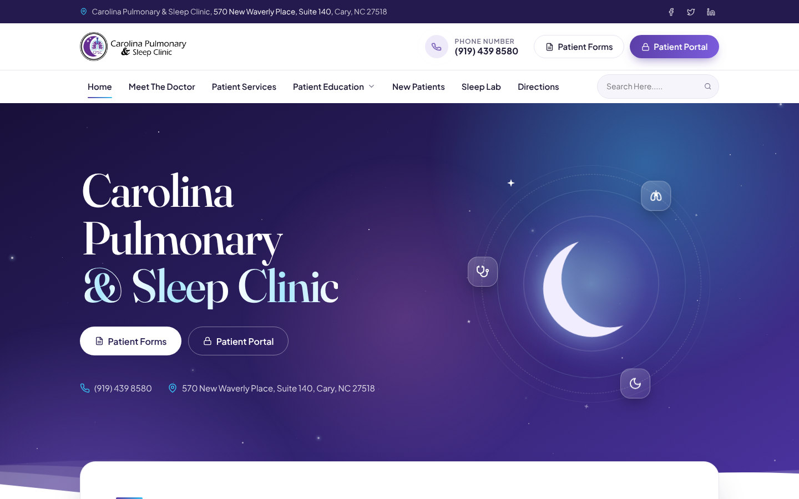
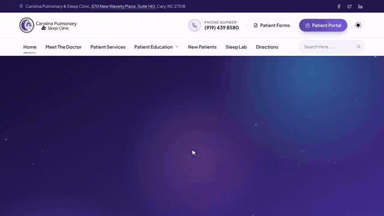
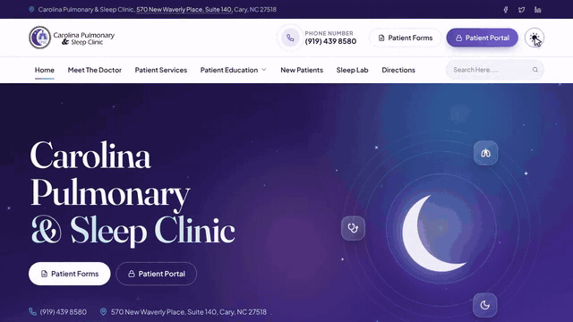
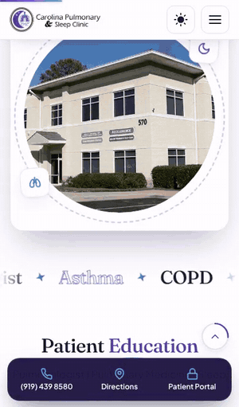
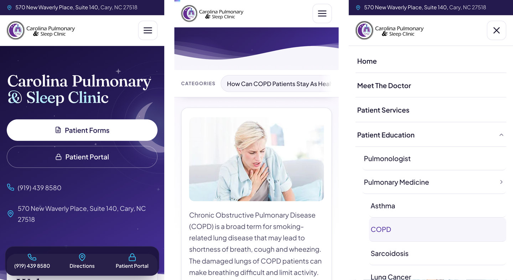
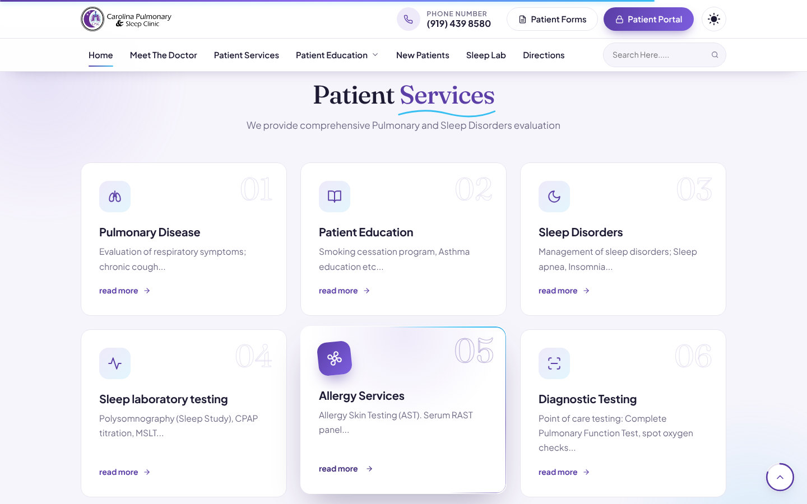
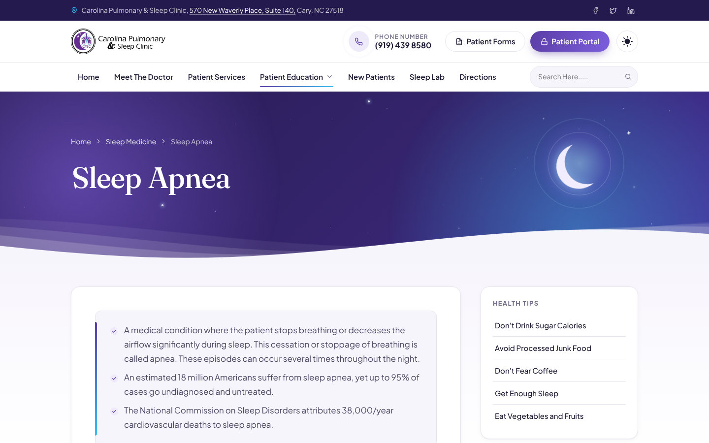

# Carolina Pulmonary & Sleep Clinic: website redesign

A modern, mobile-friendly redesign of [carysleep.com](https://carysleep.com/), the website of
Carolina Pulmonary & Sleep Clinic (Dr. Priyan Samarakoon, MD) in Cary, North Carolina, with a light and a
dark theme.

**[View the live site → 1morepush.github.io/CPSC](https://1morepush.github.io/CPSC/)**

It is a plain static site (HTML, one stylesheet and one script) with no build step and no dependencies.
Every page keeps its original file name, so links to the current site keep working once it is uploaded.

<picture>
  <source media="(prefers-color-scheme: dark)" srcset="docs/screenshots/home-desktop-dark.jpg">
  
</picture>

## Demo

Click a preview to open the full video.

**On a laptop:** the hero, scroll and hover effects, the dropdown menu and a page transition
([video, 38 s](docs/demo/desktop.mp4)).

[](docs/demo/desktop.mp4)

**Dark mode:** the switch in the header, the home page and the Directions page in the dark theme
([video, 31 s](docs/demo/dark-mode.mp4)).

[](docs/demo/dark-mode.mp4)

**On a phone:** the menu, the quick-action bar and the section chips on the COPD page
([video, 27 s](docs/demo/phone.mp4)).

[](docs/demo/phone.mp4)

## Highlights

- **Same content.** Wording, links, forms and contact details come from the live site. Only proofreading
  fixes were made (spelling, spacing, punctuation, broken in-page links), and every one is listed in
  [docs/text-corrections.md](docs/text-corrections.md).
- **New look.** A night-sky hero with drifting stars and a glowing moon, the logo's purple carried through
  the whole site, and Fraunces and Plus Jakarta Sans type.
- **Light and dark.** A sun/moon switch in the header turns on the dark theme. Pages follow the device's
  light or dark setting until a visitor picks one, then remember the choice. Printing always uses the
  light theme.
- **Motion with restraint.** Sections rise into view as you scroll, cards respond to the cursor, and pages
  cross-fade in browsers that support it. Motion switches off for visitors who turn on "reduce motion" on
  their device, and decorative loops pause while they are off screen.
- **Built for phones.** A full-screen menu, a call / directions / patient portal bar at the bottom of the
  screen, and swipeable section chips that follow along as you read. Nothing scrolls sideways, from 320 px
  phones up to tablets.
- **Fast and accessible.** WebP images, self-hosted fonts, and analytics that load after the page.
  Lighthouse (mobile): Performance 94–98, Accessibility 100, Best Practices 96–100, SEO 91–100. An
  axe-core scan (WCAG A/AA rules) reports no violations in either theme.

<picture>
  <source media="(prefers-color-scheme: dark)" srcset="docs/screenshots/phones-dark.jpg">
  
</picture>

<picture>
  <source media="(prefers-color-scheme: dark)" srcset="docs/screenshots/services-desktop-dark.jpg">
  
</picture>

<picture>
  <source media="(prefers-color-scheme: dark)" srcset="docs/screenshots/sleep-apnea-desktop-dark.jpg">
  
</picture>

Screenshots follow your GitHub theme: switch GitHub to dark mode to see the dark versions.

## Pages

| Menu | Pages |
|---|---|
| Home | `index.html` |
| Meet The Doctor | `meet_the_doctor.html` |
| Patient Services | `patient_services.html` |
| Patient Education: Pulmonary | `pulmonolgist.html`, `pulmonary_medicine.html`, `asthma.html`, `COPD.html`, `sarcoidosis.html`, `lung_cancer.html`, `bronchoscopy.html` |
| Patient Education: Sleep | `sleep_medicine.html`, `insomnia.html`, `narcolepsy.html`, `restless-legs-syndrome.html`, `parasomnia.html`, `sleep_apnea.html` |
| New Patients | `new_patients.html` |
| Sleep Lab | `sleep_lab.html` |
| Directions | `directions.html` |
| Patient Forms (header button) | `patient_forms.html`, with the 14 PDF forms in `pdf/` |

`pulmonolgist.html` keeps the old site's spelling on purpose, so existing links to it don't break.

## Run it locally

Nothing to install; any static file server works. With Python:

```sh
cd carysleep-redesign
python3 -m http.server 8000
```

Then open <http://localhost:8000>.

## Put it online

Upload the **contents** of `carysleep-redesign/` to the website's root folder, replacing the old files.
Because the file names match the current site, bookmarks, Google results and links from other sites keep
working.

### Preview link on GitHub Pages

The repo publishes the site to GitHub Pages automatically (`.github/workflows/pages.yml`) every time
`carysleep-redesign/` changes on `main`. Turn it on once:

1. On GitHub, open the repo's **Settings → Pages**.
2. Under **Build and deployment → Source**, choose **GitHub Actions**.
3. Open the **Actions** tab, pick **Deploy site to GitHub Pages**, and click **Run workflow** (or just push a change).

The site then appears at `https://1morepush.github.io/internet-mood-tracker/` (the address follows the repo
name if you rename it). Pages is free for public repositories; private ones need a paid GitHub plan.
Netlify or Cloudflare Pages work too, with `carysleep-redesign` as the publish directory.

## Editing

- Each page is a self-contained HTML file. The header, menu and footer are repeated in every page, so a
  change there (a new phone number, say) is a find-and-replace across the 20 files.
- Styles are in `css/site.css`. Colors and fonts are variables at the top: the light theme in `:root`
  and the dark theme in `:root[data-theme="dark"]`. Menus, scroll effects, animations and the theme switch
  are in `js/site.js`.
- Each photo in `images/` has a `.webp` copy next to it; replace both when swapping a photo. The logo has
  a second version with a light wordmark (`logo-dark.png` / `.webp`) for the dark theme.

## Before going live

- **Analytics:** every page still loads the old site's Google Analytics ID (`UA-135206279-1`), in the
  `<head>`. Universal Analytics stopped collecting data in July 2023, so replace it with a GA4 measurement
  ID or remove the snippet.
- **Search box:** the search field in the menu came from the old site's template and, like on the current
  site, doesn't search anything. Connect it to a site search or remove it.
- **Patient forms password:** some forms open after a password prompt carried over from the old site. The
  check runs in the browser and the password is visible in the page source, so it only deters casual
  visitors.
- **"read more" links:** the six "read more" links on the home page keep the old site's wording. Search
  engines prefer link text that says where a link goes, which is why the home page scores 91 for SEO.
- **Content to review:** a few medical statements look out of date (lung cancer screening, COPD
  statistics). They are listed at the end of [docs/text-corrections.md](docs/text-corrections.md).

## Project layout

```text
carysleep-redesign/
├── *.html            20 pages, named as on carysleep.com
├── css/site.css      all styles, light and dark
├── js/site.js        menu, scroll effects, animations, theme switch
├── fonts/            Fraunces and Plus Jakarta Sans, with their licenses
├── images/           photos and icons, each with a WebP copy
└── pdf/              patient forms
.github/workflows/pages.yml   publishes the site to GitHub Pages
docs/
├── demo/             demo videos (MP4) and their previews (GIF)
├── screenshots/      images used in this README, light and dark
└── text-corrections.md
```

## Credits

- Text, photos, logo and forms: Carolina Pulmonary & Sleep Clinic, from carysleep.com.
- Fonts: [Fraunces](https://github.com/undercasetype/Fraunces) and
  [Plus Jakarta Sans](https://github.com/tokotype/PlusJakartaSans), under the SIL Open Font License 1.1
  (license files in `carysleep-redesign/fonts/`).
