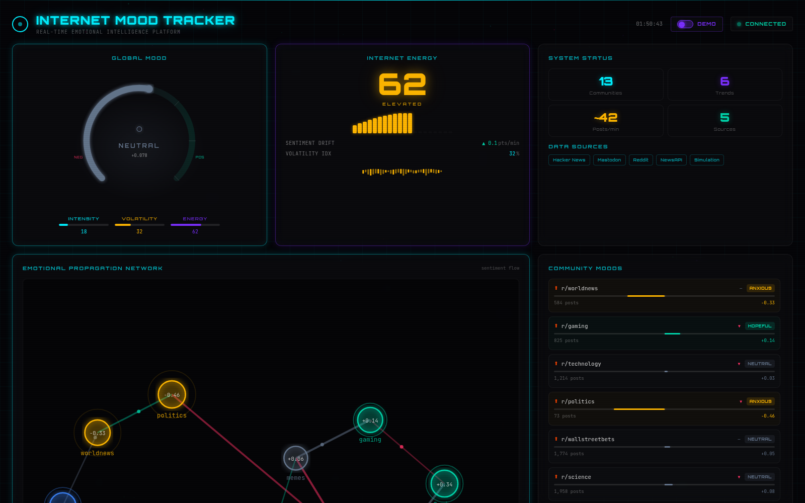
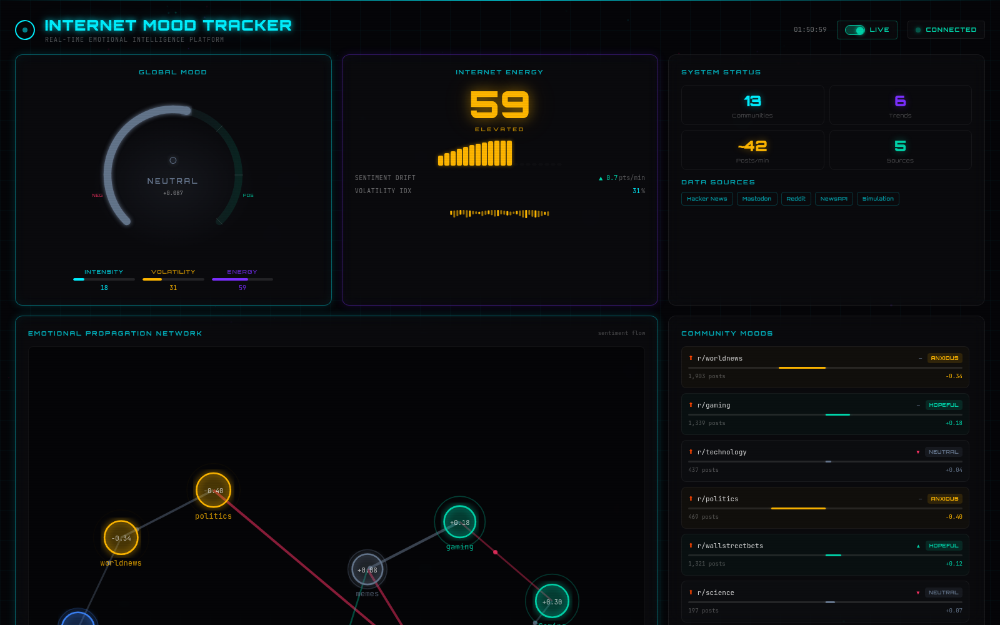
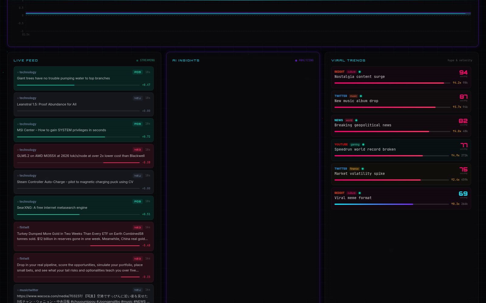

# Internet Mood Tracker

A real-time platform that analyses and visualises internet sentiment across Hacker News, Mastodon, Reddit, and news headlines — rendered as a cinematic cyberpunk dashboard.

The app works completely in **demo mode** with no backend or API keys required. Flip the **DEMO/LIVE toggle** in the header to pull real data — two of the four scrapers (Hacker News, Mastodon) need **no API key at all**, so live mode works out of the box.



*Dashboard in live mode, pulling real Hacker News + Mastodon data (toggle top-right):*



---

## What it does

The dashboard continuously monitors the emotional pulse of the internet across 13 community profiles. Every 2 seconds the system recomputes a global mood score, tracks sentiment propagation between communities, surfaces trending topics, and generates AI analyst observations.

**Eight live panels:**

| Panel | Description |
|---|---|
| **Global Mood Meter** | SVG circular gauge showing the aggregate sentiment score (-1 → +1) and current emotion state (EUPHORIC, ANXIOUS, CHAOTIC, etc.) |
| **Energy Index** | Animated waveform measuring posting intensity and volatility across all platforms |
| **Propagation Network** | Force-directed graph showing how sentiment flows between communities in real time |
| **Emotion Timeline** | Area chart of sentiment history with intensity overlay |
| **Live Feed** | Streaming posts with per-post sentiment badges and platform tags — real scraped posts in live mode |
| **Community Moods** | Per-community sentiment bars (r/worldnews, r/gaming, FinTwit, and 10 others) |
| **AI Insights** | Typewriter-animated analyst observations — LLM-generated via the HuggingFace router (free token) with built-in template fallback |
| **Viral Trends** | Top trending topics ranked by hype score with momentum indicators |

**Emotion states** (mapped from sentiment score + volatility):

`EUPHORIC` → `EXCITED` → `CONTENT` → `CALM` → `NEUTRAL` → `UNEASY` → `ANXIOUS` → `DISTRESSED` → `DEPRESSED` → `CHAOTIC`

---

## Demo mode vs. Live mode

The backend has two data modes, switchable **at runtime** with the DEMO/LIVE toggle button in the dashboard header (or via `POST /api/mode`):

- **DEMO** (default) — a simulation engine fabricates realistic mood dynamics, posts, trends, and events. Zero setup, zero keys.
- **LIVE** — real scrapers run on a schedule, score everything with VADER sentiment analysis, and blend real scores into the community moods (20% per tick). The live feed shows only genuine scraped posts.

### Data sources in live mode

| Source | API key needed? | Feeds | Interval |
|---|---|---|---|
| **Hacker News** | ❌ none | technology, science, techtwitter | 5 min |
| **Mastodon** | ❌ none | fintwit, musictwitter, techtwitter | 5 min |
| **NewsAPI** | free key ([newsapi.org](https://newsapi.org), 100 req/day) | worldnews, newsheadlines, politics | 10 min |
| **Reddit** | free app ([reddit.com/prefs/apps](https://www.reddit.com/prefs/apps)) | 8 subreddits (worldnews, gaming, wsb, …) | 10 min |

Scrapers without configured keys skip silently — live mode degrades gracefully to whatever sources are available. **Verified working with zero keys**: the live feed below is real Hacker News + Mastodon content, sentiment-scored in real time.



---

## Architecture

```
┌─────────────────────────────────────────────────────────────────┐
│  Browser                                                        │
│                                                                 │
│  Next.js 14 (App Router)  ←── WebSocket ──┐                    │
│  ├── GlobalMoodMeter                       │                    │
│  ├── PropagationNetwork                    │  ws://…/ws/feed    │
│  ├── AIInsights, LiveFeed, …               │                    │
│  ├── hooks/useMoodData.ts ── REST ────────┤                    │
│  ├── hooks/useMode.ts  (DEMO/LIVE toggle) ─┤  /api/mode         │
│  └── lib/demoData.ts (in-browser fallback) │                    │
└───────────────────────────────────────────┼────────────────────┘
                                            │
┌───────────────────────────────────────────▼────────────────────┐
│  FastAPI (Python 3.12)                                          │
│                                                                 │
│  app/main.py            WS broadcast loop + mode toggle        │
│  app/mock_generator.py  Simulation engine (blends real scores) │
│  app/sentiment.py       VADER sentiment → emotion mapping      │
│  app/state.py           In-memory deque store + real_scores    │
│  app/ai_insights.py     HuggingFace router (chat completions)  │
│  app/api/routes.py      REST endpoints                         │
│  app/scrapers/          hackernews · mastodon · newsapi · reddit│
└────────────────────────────────────────────────────────────────┘
```

---

## Quick start

### Option 1 — Frontend only (demo mode, no setup needed)

```bash
cd frontend
npm install
npm run dev
```

Open [http://localhost:3000](http://localhost:3000). The dashboard runs a full in-browser simulation with no backend required (the DEMO/LIVE toggle is hidden in this configuration since there's no backend to switch).

### Option 2 — Full stack (local dev)

**Prerequisites:** Python 3.12+, Node.js 20+

```bash
git clone https://github.com/1morepush/internet-mood-tracker.git
cd internet-mood-tracker
cp .env.example .env    # optional — only needed to add API keys
chmod +x start.sh
./start.sh
```

The script installs dependencies, waits for the backend health check, then starts the frontend.

- Frontend: [http://localhost:3000](http://localhost:3000)
- Backend API: [http://localhost:8000](http://localhost:8000)
- API docs (Swagger): [http://localhost:8000/docs](http://localhost:8000/docs)

Or start services manually:

```bash
# Terminal 1 — backend
cd backend
pip install -r requirements.txt
uvicorn app.main:app --host 0.0.0.0 --port 8000 --reload

# Terminal 2 — frontend
cd frontend
npm install
npm run dev
```

Then click **DEMO** in the header to switch to **LIVE** — Hacker News and Mastodon data starts flowing within ~15 seconds, no keys needed.

### Option 3 — Docker Compose

**Prerequisites:** Docker + Docker Compose

```bash
cp .env.example .env   # edit as needed
docker compose up --build
```

- Frontend: [http://localhost:3000](http://localhost:3000)
- Backend: [http://localhost:8000](http://localhost:8000)

> `NEXT_PUBLIC_*` values are baked into the frontend bundle at **build time** (they're passed as build args in `docker-compose.yml`). If you change them, rebuild with `docker compose build frontend`.

---

## Deploy for free

The whole stack runs on free tiers: **Render** (backend) + **Vercel** (frontend).

### Backend on Render (free)

A [Blueprint](https://render.com/docs/blueprint-spec) is included at [`render.yaml`](render.yaml).

1. Push the repo to GitHub, then in Render: **New → Blueprint** and select the repo.
2. Render reads `render.yaml` and prompts for the secret env vars (`HF_TOKEN`, `NEWS_API_KEY`, `REDDIT_CLIENT_ID`, `REDDIT_CLIENT_SECRET`). They're only needed for those optional sources — enter a placeholder like `unused` to skip them.
3. Deploy. Copy your service URL, e.g. `https://mood-tracker-api.onrender.com`.

> Free-tier caveat: Render free web services spin down after ~15 min of inactivity; the first request after idle takes ~50 s to cold-start.

### Frontend on Vercel (free)

1. In Vercel: **Add New → Project**, import the repo, set **Root Directory** to `frontend` (Next.js is auto-detected; [`frontend/vercel.json`](frontend/vercel.json) is already in place).
2. Under **Project Settings → Environment Variables** add (for Production):
   - `NEXT_PUBLIC_API_URL` = `https://<your-render-app>.onrender.com`
   - `NEXT_PUBLIC_WS_URL` = `wss://<your-render-app>.onrender.com`
3. Deploy. These values are inlined at build time — changing them later requires a redeploy.

---

## Environment variables

Copy `.env.example` to `.env`. **Everything is optional** — with no keys at all you still get demo mode plus keyless live sources (Hacker News, Mastodon). The backend loads `.env` automatically via `python-dotenv`.

```env
# ── AI Insights (optional, free) ─────────────────────────────────────────────
# Powers the AI Insights panel with real LLM generations via the HuggingFace
# Inference Providers router (free monthly credits with any HF account).
# Get a token at https://huggingface.co/settings/tokens
# Without this, insights use built-in templates instead.
HF_TOKEN=

# ── Reddit API (optional) ────────────────────────────────────────────────────
# Enables live Reddit scraping of 8 subreddits. Register a free "script" app
# at https://www.reddit.com/prefs/apps (use http://localhost:8080 as the
# redirect URI — it's never called).
REDDIT_CLIENT_ID=
REDDIT_CLIENT_SECRET=
REDDIT_USER_AGENT=InternetMoodTracker/1.0

# ── Mastodon (optional) ──────────────────────────────────────────────────────
# No account or key needed — uses public tag timelines.
MASTODON_INSTANCE=mastodon.social

# ── News API (optional) ──────────────────────────────────────────────────────
# Enables live news headlines. Free tier at https://newsapi.org (100 req/day)
NEWS_API_KEY=

# ── Backend config ───────────────────────────────────────────────────────────
BACKEND_HOST=0.0.0.0
BACKEND_PORT=8000

# ── Frontend config ──────────────────────────────────────────────────────────
NEXT_PUBLIC_API_URL=http://localhost:8000
NEXT_PUBLIC_WS_URL=ws://localhost:8000

# ── Startup mode (toggleable at runtime from the UI) ─────────────────────────
# true  = start in demo mode (default)
# false = start in live mode: Hacker News + Mastodon always run (no keys);
#         NewsAPI and Reddit run if their keys are set
USE_DEMO_MODE=true
```

---

## REST API reference

All routes are prefixed with `/api`.

| Method | Path | Description |
|---|---|---|
| `GET` | `/api/health` | Health check → `{"status":"ok"}` |
| `GET` | `/api/snapshot` | Full state snapshot (all fields) |
| `GET` | `/api/mode` | Current mode → `{"demo": true}` |
| `POST` | `/api/mode` | Switch mode at runtime — body `{"demo": false}` starts the scrapers, `{"demo": true}` stops them |
| `GET` | `/api/mood/current` | Current global mood object |
| `GET` | `/api/mood/history` | Sentiment history array |
| `GET` | `/api/communities` | All 13 community mood objects |
| `GET` | `/api/trends` | Top trending topics with hype scores |
| `GET` | `/api/insights` | Recent AI insights |
| `GET` | `/api/feed?limit=30` | Latest live posts |
| `GET` | `/api/network` | Network graph nodes and edges |
| `WS` | `/ws/feed` | WebSocket — pushes a live update every 2 seconds (includes `demo_mode`) |

Interactive docs available at `/docs` (Swagger UI) and `/redoc` when the backend is running.

---

## Project structure

```
internet-mood-tracker/
├── start.sh                  # One-command local dev launcher
├── docker-compose.yml
├── render.yaml               # Render free-tier blueprint (backend)
├── .env.example
│
├── backend/
│   ├── Dockerfile
│   ├── requirements.txt
│   └── app/
│       ├── main.py           # FastAPI app + WS broadcast + /api/mode toggle
│       ├── models.py         # Pydantic data models
│       ├── state.py          # In-memory store (thread-safe deques)
│       ├── sentiment.py      # VADER wrapper + score → emotion mapping
│       ├── mock_generator.py # Simulation engine (blends toward real scores)
│       ├── ai_insights.py    # HuggingFace router chat-completions integration
│       ├── api/
│       │   └── routes.py     # REST endpoints
│       └── scrapers/
│           ├── hackernews.py # No key needed
│           ├── mastodon.py   # No key needed (public tag timelines)
│           ├── newsapi.py    # NEWS_API_KEY
│           └── reddit.py     # PRAW, runs in a worker thread
│
├── frontend/
│   ├── Dockerfile            # NEXT_PUBLIC_* passed as build args
│   ├── vercel.json           # Vercel free-tier config
│   ├── next.config.mjs
│   ├── tailwind.config.ts    # Cyberpunk theme (custom colors, animations)
│   ├── app/
│   │   ├── layout.tsx        # Root layout (Orbitron + JetBrains Mono fonts)
│   │   ├── page.tsx          # Main dashboard — 8-panel grid + mode toggle
│   │   └── globals.css       # Scanlines, glass morphism, glow effects
│   ├── components/           # 9 dashboard panels (SVG gauge, network, charts…)
│   ├── hooks/
│   │   ├── useMoodData.ts    # Main data hook (WebSocket + REST + demo)
│   │   ├── useMode.ts        # DEMO/LIVE toggle state ↔ /api/mode
│   │   └── useWebSocket.ts   # WebSocket with exponential-backoff retry
│   └── lib/
│       ├── types.ts          # TypeScript interfaces + emotion/color constants
│       ├── demoData.ts       # Full in-browser simulation (no backend needed)
│       └── api.ts            # REST fetch helpers
│
├── docs/
│   └── screenshots/          # README screenshots (captured from a real run)
│
└── .github/
    └── workflows/
        └── ci.yml            # GitHub Actions CI
```

---

## CI / CD

GitHub Actions runs on every push and pull request to `main`.

**Frontend job** (`frontend/`):
1. `npm ci` — install dependencies
2. `npx tsc --noEmit` — TypeScript type-check
3. `npx next lint --max-warnings 0` — ESLint
4. `npm run build` — production build

**Backend job** (`backend/`):
1. `pip install -r requirements.txt`
2. `python -c "from app.main import app"` — import sanity check

---

## Tech stack

| Layer | Technology |
|---|---|
| Frontend framework | Next.js 14 (App Router) |
| UI language | TypeScript |
| Styling | Tailwind CSS (custom cyberpunk theme) |
| Animations | Framer Motion |
| Charts | Recharts |
| Icons | Lucide React |
| Backend framework | FastAPI |
| Backend language | Python 3.12 |
| Sentiment analysis | VADER (`vaderSentiment`) |
| AI insights | HuggingFace Inference Providers router (Llama 3.2 3B, free credits) |
| Scrapers | httpx (async) + PRAW (threaded) |
| Real-time transport | WebSocket (`websockets`) |
| Containerisation | Docker + Docker Compose |
| Free hosting | Render (backend) + Vercel (frontend) |
| CI | GitHub Actions |
